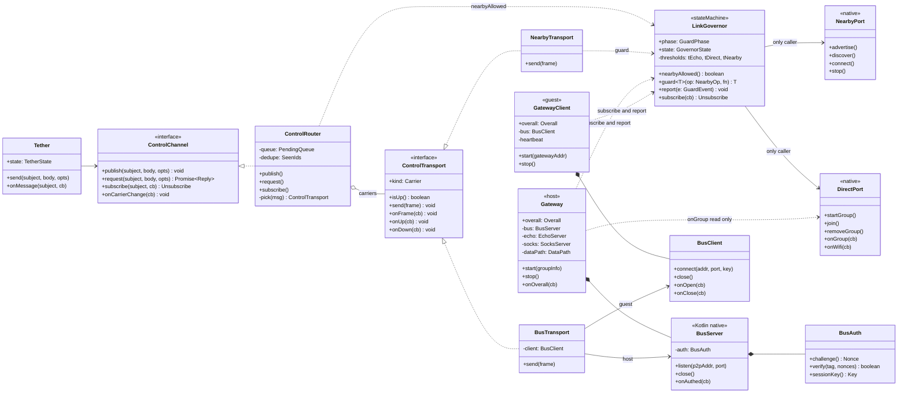
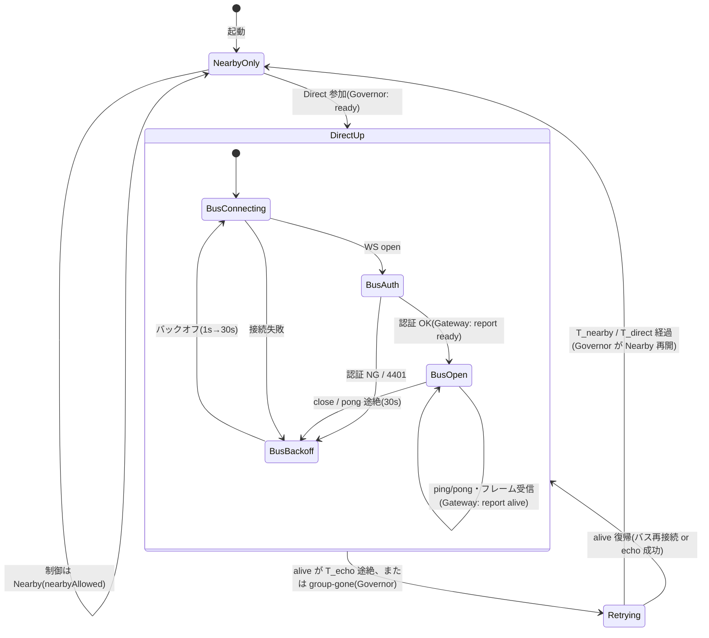

# Gateway と軽量メッセージバス(Wi-Fi Direct 接続後の制御経路)— 設計書

状態: 設計(#17)+ **第1段を実装(§11。方式は §2.3 の自作 WebSocket でなく ZeroMQ に変更。差分は §11.1)**。2026-10-21。
関連: `docs/SPEC.md`(方式・セキュリティ)、`docs/API.md`(公開 API)、suspend 設計(`feat/suspend-nearby-while-direct`。`src/link/directGuard.ts` / `dataPath.ts`。未コミット・未 PR の作業中なので、名前と閾値は変わりうる。本書では `LinkGovernor` と呼ぶ)。

方針(Kaz): **Wi-Fi Direct 接続後は Nearby のメッセージを使わない。Gateway を設け、WebSocket か NATS か、軽量なメッセージバスを作って接続する。**

## 1. 目的・非目的・要件

### 1.1 背景
- これまで制御メッセージ(`tether.unpair`・`tether.app`(guest-apps・設定同期など)・`tether.hello/caps/plan`・ペア情報の再送・`tether.wifi`・`tether.need-wifi`)は、すべて Nearby Connections の BYTES で運んでいた(`src/api/tether.ts` の `Wire`、`src/link/supervisor.ts` の `Frame`)。
- 実機で、Direct が生きている間に Nearby が(再)接続すると、GMS が帯域アップグレード先に Wi-Fi Direct を選び、固定グループを撤去することが確認された(`directGuard.ts` の説明: razr 09:01 / 09:07 / 09:20 / 09:26)。公開 API に止める手段が無いので、suspend 設計は「Direct が生きている間は Nearby を止める」。
- すると **Direct 稼働中の制御メッセージの運び先が無くなる**。これを Direct 上のバスで埋める。

### 1.2 目的
1. Direct 稼働中(= Nearby が suspend 中)も、親機・子機間の制御メッセージを届ける。
2. 親機側の「窓口」として Gateway を置き、バスのサーバー・認証・echo/SOCKS の起動と停止・状態の集約を 1 か所に持つ。
3. 制御の送り手(`Tether`)から見て、運び先(Nearby / バス)を差し替えても変わらない抽象(`ControlTransport`)にする。

### 1.3 非目的
- データ(SOCKS5 の通信)をバスに載せない。データ経路は今のまま(VPN → SOCKS5 → 回線)。
- 3 台以上のメッシュ、ブローカーの永続化、JetStream 相当の保存・再生はしない。
- Nearby を捨てない。**探す・見つける・Direct の接続情報を最初に渡す**のは Nearby のまま(Direct が無いときは他に手段が無い)。
- ユーザー向けに「暗号化している」とは言わない(画面・説明文・ストア文面)。技術文書内で TLS の要否を検討するのは可(§7.3)。

### 1.4 要件
| 区分 | 要件 | 備考 |
|---|---|---|
| 軽量 | 追加依存は小さく。常駐プロセスを増やさない | 端末 2 台・子機 1〜数台 |
| 背景・画面オフ | 前面サービス(`modules/keep-alive`)の下で、Doze・画面オフでも切れない/切れたら検知して戻る | JS タイマーは背景で止まりうる(§5.3)。実機で未検証 |
| OS | Android 16 / 17。minSdk は現状の設定に従う | 親機のサーバーソケットは前面サービス内で動かす |
| RN | 子機(React Native)から使える。親機は Kotlin | 親機の JS は止まりうるので、サーバーは Kotlin |
| 遅延 | 制御は 100 ms 級で十分(Direct の RTT は数 ms〜数十 ms) | 秒級でよい用途がほとんど |
| 信頼性 | `ctl.*` は at-least-once + 重複排除、`hb.*`・`state.*` は at-most-once | §6.3 |
| 順序 | 同じ送り手・同じ接続セッション内は FIFO(TCP 順序)。再接続をまたぐ再送も送信順を保つ | 件名をまたぐ順序は保証しない |
| 切断検知 | 30 秒以内に検知(ping/pong)。検知後は指数バックオフで再接続 | `LinkSupervisor` の `backoffMs` と同じ形 |
| 認証 | ペアの共有コードから導出した鍵で相互認証。Direct グループに他の端末が入っても受け付けない | §7 |
| ログ | 秘密(共有コード・鍵・トークン・SOCKS 資格情報・ノンスの全体)を出さない | §7.5 |
| 可観測 | 総合状態 `connected|degraded|disconnected` を Gateway が集約して公開 | §4.3 |

## 2. 候補の比較

事実(出典あり)と推測、未確認を分けて書く。

### 2.1 事実として確認できたこと
- **NATS(nats.ws)**: クライアントに必要なのは W3C WebSocket のみ(README)。サーバーは既定で WSS のみで、平文 `ws://` には設定が要る(README の記述。`websocket { no_tls: true }` の設定名は私の知識で、今回は一次情報を未確認)。再接続は既定で有効(待ち 2 秒、試行 10 回、`-1` で無制限)。**リポジトリは archive 済みで、nats.js に統合された**(README の移行案内)。React Native での動作は README に記載なし。 — https://github.com/nats-io/nats.ws
- **nats-server**: 単一の自己完結バイナリで、Raspberry Pi などエッジでも動かせると配布元が説明している(Debian パッケージの説明)。linux/arm64 の配布はある。**Android 向けのビルド・実行例は検索で見つからなかった**。
- **MQTT**: HiveMQ Community Edition を Android 端末内で動かすことは、HiveMQ の担当者が「サポートも検証もしていない」と回答している(HiveMQ コミュニティ)。Moquette ベースの組み込みブローカーを Android で使った例は B4A(別言語基盤)のラッパーのみ。KMQTT(Kotlin Multiplatform のクライアント+組み込み可能ブローカー)は存在するが、Android での実績は確認できなかった。クライアントの paho.mqtt.android は版によって WorkManager 方式と前面サービス方式がある。
- **React Native の WebSocket**: 背景に回ると接続が静かに落ちる/落ちたことに気づけない事例が多数報告されている(forum・ブログ。個別の再現条件は不明)。Android の RN は WebSocket を標準で持つ(私の知識。OkHttp ベース)。**RN 標準には生の TCP ソケットが無い**(私の知識。`react-native-tcp-socket` などの追加が要る)。

### 2.2 比較表
| | (a) WS 上の自作軽量 pub/sub+req/reply | (b) NATS | (c) MQTT | (d) TCP + 行 JSON |
|---|---|---|---|---|
| 親機のサーバー | Kotlin に小さな WS サーバー(ライブラリ or 自前 RFC6455)。**同じプロセス内** | `nats-server` を端末で動かす必要。Android 向けビルド・exec は**未確認**。推測: ネイティブライブラリ(`.so`)として同梱して実行する形になり、ABI・Play ポリシーの確認が要る。別プロセスは前面サービスの管理が増える | 組み込みブローカーが要る。Android で実績のあるものは**未確認**(HiveMQ CE は非対応と回答あり) | Kotlin の `ServerSocket`(echo と同じ) |
| 子機クライアント | RN 標準の WebSocket で足りる(追加依存なし)。背景で止まる懸念は §5.3 | nats.ws / nats.js。RN での動作は**未確認**(WebSocket があれば動く設計だが、TextEncoder など周辺の有無は未確認) | RN 用クライアントは追加ライブラリ。品質は**未確認** | RN は生 TCP が無い → 追加ネイティブ依存か自作モジュール |
| サイズ・電池 | 追加は小さい(推測: ライブラリ数百 KB 以下)。サイズは PR 2 で計測 | nats-server は数十 MB 級の Go バイナリと推測(**未確認**)。常駐プロセスが 1 つ増える | ブローカー次第 | 最小 |
| 機能 | 必要なものだけ作る(subject・req/reply・ack・ping)。**作る量が増える**のが欠点 | subject・req/reply・queue group が最初から揃う。永続化(JetStream)は不要 | QoS 0/1/2・retained・LWT が揃う。request/reply は MQTT 5 で可 | 枠(フレーミング)・ping・認証を全部自作 |
| 認証 | 自前(HMAC チャレンジ。§7) | NATS の token/nkey/user。共有コード由来の鍵への対応は設定生成が要る | ユーザー/パスワード。同上 | 自前 |
| 将来の拡張 | subject を NATS 互換の名前にしておけば、後で (b) に載せ替え可能 | 最大 | 中 | 小 |
| 主なリスク | 自作の不具合(再接続・重複排除) | **端末で動かせるか不明**がそのまま採用不能の可能性 | 同上(ブローカー) | 自作の範囲が (a) より広く、RN で追加依存 |

### 2.3 推奨: (a) 親機 Kotlin の WebSocket サーバー + subject ベースの自作軽量バス
理由:
1. 追加の常駐プロセスが無い。親機は既に Kotlin モジュールの中で echo(9000)・SOCKS(1080) のサーバーを動かしており、同じ型で足せる(`SocksServer.kt` も自前実装)。
2. 子機は RN 標準の WebSocket で足りる。TCP + 行 JSON(d)は RN に生 TCP が無く、追加ネイティブ依存が要る。
3. NATS(b)・MQTT(c)は、端末内でブローカーが動くことが**確認できていない**。確認に時間を使うより、必要な機能(後述の 3 つ)だけを自作する方が小さい。
4. 必要な機能は小さい: **subject による publish/subscribe、request/reply、ack(at-least-once)**。件名を NATS 風(`.` 区切りのトークン、空白なし)にしておけば、将来 (b) に載せ替えられる(§6.1)。

覆る条件(PR 2 の最初の spike で確認する): (i) Kotlin の WS サーバー実装が前面サービスの下で安定しない、(ii) RN の WebSocket が背景で頻繁に落ちて native クライアントが必要になる(§5.3 に退避策あり)、(iii) 自作の部分(再送・重複排除)が想定よりかさむ。その場合は (d) ではなく、まず (b)/(c) の動作可否(Android での実行・RN のクライアント)を実測する。

## 3. 全体像

```
親機(razr)                                          子機(Pixel)
┌───────────────────────────────┐                   ┌─────────────────────────────┐
│ Tether(API)                   │                   │ Tether(API)                 │
│   │ ControlChannel(subject)   │                   │   │ ControlChannel          │
│   ▼                           │                   │   ▼                         │
│ ControlRouter ─┬ NearbyTransport ◀── Nearby(BT) ──▶ NearbyTransport ┬ ControlRouter│
│                └ BusTransport   ◀── WS over Direct ─▶ BusTransport ──┘            │
│ Gateway                       │                   │ GatewayClient               │
│  ├ BusServer(WS, p2p のみ bind)│                   │  └ BusClient(WS)            │
│  ├ EchoServer(9000)           │◀── TCP ───────────│ heartbeat / probe           │
│  ├ SocksServer(1080)          │◀── SOCKS5(VPN)────│ VpnService + tun2socks      │
│  └ 総合状態の集約 → Overall    │                   │                             │
│ LinkGovernor(Nearby/Direct を │                   │ LinkGovernor                │
│   触る操作の唯一の窓口)        │                   │                             │
└───────────────────────────────┘                   └─────────────────────────────┘
```

## 4. Gateway の役割

### 4.1 Gateway がやること(親機)
| 役割 | 内容 |
|---|---|
| バスのサーバー | WebSocket サーバー(`BusServer`)。Direct の p2p インターフェースのアドレスだけに bind(§7.1) |
| 認証 | 接続ごとに HMAC チャレンジ。失敗は切断し、回数制限(§7.2) |
| echo / SOCKS の所有 | 今は `Tether`(`tether.ts` の `startEcho` / `stopEcho` と `startSocks`)が個別に呼んでいる。これを Gateway に集め、**起動順(先にエコーと SOCKS → 後で接続情報を渡す、SPEC §3-3)**と停止を 1 か所で管理する |
| 状態の集約 | データ経路の入力(group・echo の最終受付・バスの生存・到達確認)を集め、`deriveOverall`(suspend 設計の `dataPath.ts`)で `connected|degraded|disconnected` を作って公開する(§4.3) |
| 生存信号の供給 | バス上の pong・受信フレーム、echo 受付を、LinkGovernor へ `alive` として渡す(§4.4) |

子機には対になる `GatewayClient` を置く(バスクライアント、ハートビート、到達確認、総合状態の算出)。**子機にサーバーは無い**(Gateway は親機の概念。子機の部品は GatewayClient と呼ぶ)。

### 4.2 Gateway と SOCKS / echo / VPN / heartbeat の関係
- **SOCKS(1080)**: Gateway が起動・停止を所有する。データ経路そのもので、バスとは独立。バスが落ちても SOCKS は止めない(バスの断はデータの断ではない)。
- **echo(9000)**: 当面そのまま残す。役割は「SOCKS と同じ経路で TCP が張れるか」の探針。バスの WebSocket とは別の接続で、バスの不具合とデータ経路の不具合を切り分けられる。
- **VPN(子機)**: 子機の VPN 起動・停止は今までどおり子機の `Tether` が持つ。バスの断では VPN を落とさない(従来どおり、VPN の fail-open はデータ経路の断で決める)。
- **heartbeat**: 今は suspend 設計で「子機が echo に定期接続 → 親機は `echoAt` を見る/子機は成功時刻を見る」。これを**バス上の ping/pong(+ `hb.guest`)にも持たせ、どちらか一方でも新しければ生存**とする(OR)。理由: (1) バスだけに寄せると、バスの実装不具合が Direct の生死と誤認される、(2) echo は旧版の相手との互換、(3) 将来バスが安定したら echo を探針だけに縮められる。切り替えの判断材料: 実機でバスの ping/pong が echo と同等に切断を検知するか(§9.3)。
  - T_echo / T_direct / T_nearby の閾値の意味は suspend 設計のまま。**閾値と状態遷移は LinkGovernor が持つ。Gateway は閾値を持たない。**

### 4.3 総合状態
- 入力: `DataPath`(`dataPath.ts`)に `bus: { open: boolean; aliveAt: number | null }` を足す(提案)。`deriveOverall` は「バスは参考」とし、**connected の条件にバスを含めない**(データが流れることが connected の定義。バスだけ落ちたときは degraded にする案を第一案とする。理由: 制御が届かないのは利用者にとって劣化)。
- 公開: `Tether.state.overall`(既存)に加え、`gateway: { bus: 'open'|'closed'|'connecting', overall }` を `TetherState` に出す。
- 親機は `degraded` の間も SOCKS を止めない。

### 4.4 LinkGovernor との責務分担(決定)

**原則: Nearby/Direct を触る操作と、その判断(状態機械・不変条件・閾値)は LinkGovernor だけが持つ。Gateway は Direct 上の部品(バス・echo・SOCKS)を持ち、生存の事実を Governor に報告する。Gateway は Nearby に一切触れない。**

| 論点 | 決定 | 理由 |
|---|---|---|
| Gateway は Governor の状態を購読するか | **する(読み取り専用)**。ただし使い道は表示(総合状態の `retrying`/`nearby` 入力)と、運び先の選択(§4.5)だけ。バスの開閉は Governor の phase では決めない | phase は「Nearby を止めるか」の判断で、バスの開閉に使うと、閾値の変更がバスの挙動に波及する |
| バスの開閉の根拠 | **Direct の事実**で決める。親機: p2p グループがある間 listen。子機: Wi-Fi(Direct)に参加している間、接続を試みる | Direct が生きている限りバスは使える。Governor がグループを閉じたら(group-gone)バスも閉じる |
| バスの切断検知を Governor へ通知するか | **「切断」は通知しない。「生存」を通知する**: `alive`(認証済みフレーム・pong の受信)と `ready`(子機: 認証完了/親機: 子機の初回認証) | Governor は既に「最後に生存を確認した時刻」から T_echo / T_direct を数える設計。バスの切断は**時間が経っても alive が来ない**ことで自然に伝わる。切断を別イベントにすると、バスの一瞬の再接続で Governor が揺れる |
| Nearby を使ってよいか | `ControlRouter` は Nearby に送る前に **`governor.nearbyAllowed()`** を確認する。禁止中は Nearby を呼ばず、バスか待ち行列へ | 不変条件(Direct 稼働中は Nearby を使わない)を一元化するため、Nearby への送信も Governor 経由にする(Governor の `guard` 経由で `NearbyTransport` を呼ぶ) |
| echo / SOCKS の起動順 | Governor の `ready` 判断の前に Gateway が済ませる。Gateway は起動結果(成功/失敗)を Governor に報告 | SPEC §3-3(先に起動)を守る |
| 再接続の順序 | Governor が決める(Direct の再試行 → T_direct/T_nearby で Nearby 再開)。Gateway は Direct が戻ったらバスをつなぎ直し、`ready` を再度報告 | 再接続順序の知識を 1 か所に |

### 4.5 ControlTransport の切り替え
Nearby を suspend しても送りたいメッセージはある。`ControlRouter` が、メッセージごとの種類(§6)と状態で運び先を選ぶ。

| 状況 | 運び先 |
|---|---|
| バスが認証済み | バス(`BusTransport`) |
| バスが無い、かつ `nearbyAllowed()` | `NearbyTransport` |
| どちらも無い | 待ち行列(`ttlMs`・`key` は既存の `LinkSupervisor` と同じ意味。QoS により再送) |
| 例外: `ctl.wifi`(Direct の接続情報) | **常に Nearby**(Direct が無いときに送るものなので) |

切り替え時の重複: Nearby で送って ack 前にバスへ切り替わったメッセージは、`msgId` で受け側が重複排除する(§6.3)。

### 4.6 クラス図



読み方: 矢印は「呼ぶ」。`LinkGovernor` から `NearbyPort` / `DirectPort` への矢印は**この 1 本だけ**にする(他のクラスは Port を直接呼ばない)。Gateway から Governor への矢印は `report` と `subscribe` だけで、Governor から Gateway への指示は無い(Gateway が Governor に従うのは `nearbyAllowed` を介する運び先の選択のみ)。

### 4.7 型の素案(実装ではなく設計の確認用)
```ts
// 運び先。既存の Transport(Frame) とは別に、subject 単位の層を ControlRouter が持つ。
type Carrier = 'nearby' | 'bus';
interface ControlTransport {
  readonly kind: Carrier;
  isUp(): boolean;
  send(m: BusMessage): void;
  onMessage(cb: (m: BusMessage) => void): void;
  onUp(cb: () => void): void;
  onDown(cb: () => void): void;
}

interface SendOpts { qos?: 0 | 1; ttlMs?: number; key?: string; carrier?: Carrier | 'auto' }

// 線の上のメッセージ(JSON 1 件 = WS のテキストフレーム 1 つ)
interface BusMessage {
  v: 1;
  op: 'pub' | 'req' | 'rep' | 'ack';
  subj: string;          // 'ctl.unpair' など。トークンは [a-z0-9-]、'.' 区切り、最大 64 文字
  id: string;            // 送り手ごとに単調増加 `${sid}:${n}`。at-least-once の重複排除と ack に使う
  re?: string;           // rep/ack が応えている id
  qos?: 0 | 1;
  ts: number;            // 送り手の時刻(ms)。順序には使わない(参考)
  body?: unknown;        // JSON。上限は §6.2
  err?: { code: string; message: string };   // rep 用
}

// Governor へ渡す事実(suspend 設計の GuardEvent に追加・流用)
type GatewaySignal =
  | { t: 'ready'; via: 'bus' | 'echo' }
  | { t: 'alive'; via: 'bus' | 'echo'; at: number };
```

## 5. バス(WebSocket)の設計

### 5.1 接続
- 親機: `ws://<p2p アドレス>:<busPort>/bus/v1`。`busPort` は固定値(案: 9001。echo 9000 の隣)。
- 子機: Direct 参加後、ゲートウェイアドレス(`tether.wifi-result` が既に持つ `gateway`)へ接続。**接続先ポートは `ctl.wifi` の本文に `busPort` を足して渡す**(Nearby で運ぶ。古い版の親機が `busPort` を送らなければバスは使わず、従来どおり Nearby)。
- サブプロトコル: `Sec-WebSocket-Protocol: dh-bus.v1`。版の不一致は 4400 で切断。
- 子機が複数ぶら下がる場合、親機の `BusServer` は接続ごとに `peerId`(認証で確定)を持つ。子機 1 台あたり 1 接続。同じ peerId の新しい接続が来たら古い方を閉じる。

### 5.2 状態遷移(子機のバスと、Governor との関係を含む)


- `DirectUp` の間、Governor は Nearby を止めている。制御はバス(`BusOpen`)だけ。`BusBackoff` 中のメッセージは `ControlRouter` の待ち行列に溜まる(Nearby は禁止中)。
- バスが落ちても `DirectUp` から出るのは Governor の判断(alive 途絶)による。バス自身が Nearby を呼ぶ道は無い。

親機側は `BusListening`(グループがある間)→ 接続ごとに `Authenticating` → `Open` → `Closed`。グループ消滅で全接続を閉じ、listen を止める。

### 5.3 背景・画面オフでの安定性
- 親機: サーバーは Kotlin のスレッドで動く。前面サービス(`connectedDevice`)の下にあり、JS の停止に影響されない。**親機の Gateway のロジック(認証・ping 応答)は Kotlin に置く。**
- 子機: RN の WebSocket と JS タイマーは、背景で止まる・静かに落ちるという報告がある(§2.1)。子機は `modules/keep-alive` の前面サービスで延命しているが、**JS の ping タイマーが背景で動くかは未検証**。
  - 退避策(PR 3 の spike で判断): ping/pong とバックオフ再接続を Kotlin の native クライアント(OkHttp WebSocket。RN が既に抱えている依存と同じと推測)に置き、JS へはイベントだけ渡す。TS の `BusClient` インターフェースは同じなので、差し替えが効く。
  - 画面オフ・Doze での維持は SPEC §5 でも未検証の項目。同じ耐久テストに含める。

### 5.4 サーバー実装の選択肢(PR 2 の spike で決める)
| 案 | 利点 | 欠点 |
|---|---|---|
| Java-WebSocket / Ktor CIO などのライブラリ | 実装が早い。RFC6455 の細部が済み | サイズ・R8/ProGuard・Expo ビルドとの相性が未確認 |
| 自前 RFC6455(テキストフレームのみ、断片化なし、マスクあり、ping/pong/close) | `SocksServer.kt` と同じ流儀。依存ゼロ。約 300 行と推測 | 仕様の穴を自分で埋める。テストを手厚く |
- どちらでも、`BusServer` の公開面(`listen / close / send / onAuthed / onMessage / onClose`)を同じにして差し替え可能にする。

## 6. メッセージ設計

### 6.1 subject 一覧
命名: `<クラス>.<名前>`、トークン `[a-z0-9-]`、`.` 区切り。NATS の subject 規則に収まる。ワイルドカードは v1 では**使わない**(完全一致のみ)。

| subject | 向き | QoS | 内容 | 現行の `Wire` |
|---|---|---|---|---|
| `ctl.hello` | 双方 | 1 | 版・能力の版(rev) | `tether.hello` |
| `ctl.caps-req` / `ctl.caps` | 双方 | 1(req/reply) | 能力の要求・応答 | `tether.caps-req` / `tether.caps` |
| `ctl.plan` | 親→子 | 1 | 方式判断の通知 | `tether.plan` |
| `ctl.unpair` | 双方 | 1 | ペア解除の通知 | `tether.unpair` |
| `ctl.wifi` | 親→子 | 1(**Nearby 固定**) | Direct の接続情報(+ `busPort`) | `tether.wifi` |
| `ctl.wifi-result` | 子→親 | 1 | 参加結果・到達確認 | `tether.wifi-result` |
| `ctl.need-wifi` | 子→親 | 1 | 子機が Wi-Fi を必要としている | `tether.need-wifi` |
| `ctl.guest-apps` | 子→親 or 親→子 | 1 | 子機のアプリ一覧(配達ヘルパー側)。**現行は `tether.app` の body に載っている想定(未確認)** | `tether.app` |
| `ctl.settings` | 双方 | 1(key で最新のみ) | 設定同期 | `tether.app` の body(未確認) |
| `ctl.app` | 双方 | 1 | 利用側アプリの任意メッセージ | `tether.app` |
| `hb.guest` | 子→親 | 0 | 子機のハートビート(時刻・VPN 状態の要約) | (echo 接続) |
| `state.link` | 親→子 | 0(key で最新のみ) | 親機の総合状態・Gateway の状態 | (なし) |

移行: `Wire.kind` の `tether.X` を `ctl.X` に 1 対 1 で対応させ、`ControlRouter` が内部で変換する。**本文の型(`Wire`)は変えない**ので、`tether.ts` の `handleWire` はほぼそのまま使える。

### 6.2 ペイロード
- 形式: UTF-8 の JSON、WebSocket のテキストフレーム 1 つにメッセージ 1 件。バイナリは使わない。
- 上限: 1 メッセージ 64 KiB(WS サーバー側で `maxFrame` を設定)。超えたら 1009 で切断。`ctl.guest-apps` のように大きくなりうるものは、送り手が分割するか、要約にする(上限は PR 2 で実測して見直し)。
- 未知の subject・未知のフィールドは無視(前方互換)。`v` が違えば切断。

### 6.3 request/reply と QoS
- **request/reply**: `op:'req'` に `id`。応答は `op:'rep'`、`re` に要求の `id`。タイムアウトの既定 10 秒。応答が無ければ reject。`err` 付きは失敗。
- **QoS 0(at-most-once)**: `hb.*`・`state.*`。送って終わり。切断中は捨てる(`ttlMs: 0` と同じ)。`key` 付きなら最新のみ。
- **QoS 1(at-least-once)**: `ctl.*`。受け手は処理後に `op:'ack'`(`re` = `id`)を返す。送り手は ack が来るまで保持し、切断→再接続で**送信順に再送**する。
  - 受け手は `(送り手の sid, n)` で重複排除する(直近 256 件、または送り手ごとの最大 n)。`sid` は送り手が起動ごとに作るランダム値。
  - 保持は送り手のメモリ内(アプリ再起動で消える)。`ctl.unpair` のように消えると困るものは、Tether 側の既存の冪等な再送(ペア状態の突き合わせ)に任せる。**永続キューは作らない**(非目的)。
  - `ttlMs`・`key` の意味は既存の `LinkSupervisor`(`SendOptions`)と同じ。
- **順序**: 同じ接続・同じ送り手は FIFO。キャリアをまたいで切り替わった場合の順序は保証しない。順序が要るメッセージ(`ctl.plan` の更新など)は `key` で最新のみとし、受け手側で `rev` を見る。

### 6.4 再接続時
1. バス再接続・認証完了で、Gateway が `ready` を Governor に報告し、`ControlRouter` がキューを送信順に再送する。
2. 親機は `state.link` の最新値を再送する(最新のみなので、取りこぼしは問題にならない)。
3. 子機は `ctl.hello` を再送し、能力の版が同じなら `caps` は再送しない(既存の rev の仕組み)。

## 7. セキュリティ

### 7.1 bind
- `BusServer` は **Direct のグループのインターフェースのアドレス**(`WifiP2pGroup.getInterface()` が返す名前の IPv4。通常 192.168.49.1 付近)にだけ bind する。`0.0.0.0` にしない。LOHS のときは LOHS のインターフェースのアドレス。アドレスは Gateway がグループイベントから取る(固定値を書かない)。
- 受け入れ時に、相手の IP が同じサブネット内であることも確認する(多重の防御)。
- **既存の不整合(§10)**: `SocksServer.kt` と echo は現状ワイルドカードで bind している。SPEC §4 は「Direct/LOHS のインターフェースのみ」と書くが、コードは `InetSocketAddress(port)`。Gateway の導入(PR 2)で、echo・SOCKS も同じ bind に揃える。

### 7.2 認証(HMAC チャレンジ・応答、相互)
- 鍵: `K_bus = HMAC-SHA256(pairSecret, "dh-bus/v1")`。ペアの共有コード自体は送らない。ペアごとに別の鍵になる。
- 手順(WS が開いた直後、3 秒以内に完了しなければ 4408 で切断):
  1. 親→子: `{ nS }`(32 バイトの乱数。接続ごとに新しく、一度使ったら捨てる)
  2. 子→親: `{ peerId, nC, tagC = HMAC(K_bus, "c" | nS | nC | peerId | hostId) }`
  3. 親→子: `{ tagS = HMAC(K_bus, "s" | nS | nC | peerId | hostId) }`(子機が親機を確認)
  4. 以降のセッション鍵 `K_s = HMAC(K_bus, nS | nC)`。
- ノンスは接続ごと・方向ごとに新規 → 録画の再送(リプレイ)を受け付けない。`nS` を親機が出す側なので、子機が固定値を再送しても通らない。
- 不一致: 4401 で切断。失敗が同じ IP から 5 回/分を超えたら 30 秒受け付けない。**認証前に受け付けるフレームは認証メッセージだけ**(他は即切断)。
- 他の端末が Direct グループに入った場合: グループに入るには Direct の固定パスフレーズ(ペアの共有コード由来)が要るため、通常は入れないが、仮に入って TCP をつないでも、`K_bus` を持たないので認証が通らない。SOCKS・echo は別途資格情報/受け付け条件で守る(SPEC §4)。
- ペア解除: `ctl.unpair` を処理したら、そのペアの接続を全て閉じ、`K_bus` を捨てる(共有コードの破棄と同時)。

### 7.3 TLS の要否(技術的な検討。ユーザー向けの文言にはしない)
- Direct は WPA2/WPA3-PSK でリンクが保護されており、パスフレーズはペアごとに導出される。
- バスを `wss://` にするには、証明書をどう配るか(自己署名+ピン留めの配布方法)が要る。ペアリング時に証明書の指紋を共有コードと一緒に交換する案はあるが、複雑さが増える。
- **v1 の決定: TLS なし(`ws://`)**。認証は§7.2、`ctl.*` の本文には `K_s` による MAC(`mac` フィールド、本文のハッシュ)を付けて、改ざん・差し込みを防ぐ。再検討の条件: LOHS など、リンク層の保護が弱い方式をバスに使うとき(LOHS でバスを有効にするかは PR 2 で決める。初版は Direct のみ)。

### 7.4 認証前の公開面
- 認証前に見える情報は、WebSocket のサブプロトコル名と版だけ。機種名・ペア ID・状態は認証後に初めて出す。

### 7.5 ログ
- 出してよい: 接続・切断・認証成否・理由コード・subject・サイズ・遅延、相手 IP の末尾オクテット。
- 出さない: 共有コード、`K_bus`、`K_s`、ノンスの全体、タグ、SOCKS 資格情報、`ctl.wifi` の passphrase、メッセージ本文。本文はサイズだけ。ノンスは先頭 4 文字まで(既存の DhLog の流儀に合わせるが、**本番ビルドでは出さない**。SPEC §4 の「ログ」の行)。
- `ctl.wifi` は引き続き Nearby 専用で、本文をログに出さない。

## 8. 実装計画

### 8.1 PR の分割
| # | PR | 内容 | 依存 |
|---|---|---|---|
| 1 | ControlTransport 抽象と Nearby 実装 | `ControlChannel` / `ControlRouter` / `ControlTransport` を TS に。`NearbyTransport` を適合させる。`Wire.kind` ⇄ subject 変換、QoS 1 の ack・重複排除・待ち行列(既存 `LinkSupervisor` の機能と重なる部分は流用)。**振る舞いは今と同じ(バスはまだ無い)**。`nearbyAllowed()` は常に true | なし(suspend の PR と独立。LinkGovernor が入った後に `nearbyAllowed` を結ぶ) |
| 2 | 親機 Gateway + WebSocket サーバー(Kotlin) | `modules/hotspot` の隣(新規モジュール `gateway` を推奨)に `BusServer`・`BusAuth`・Gateway(echo/SOCKS の所有を移す)。bind を p2p のみに揃える。TS の薄い橋(`startBus` / `onBusMessage` / `sendBus`)。最初に spike(§5.4) | 1、LinkGovernor の `report` |
| 3 | 子機クライアント | `BusClient`(RN WebSocket。必要なら native)、`BusTransport`、認証、再接続。`ctl.wifi` に `busPort` を足す(古い版は無視) | 2 |
| 4 | 総合状態の公開 | `DataPath.bus`、`deriveOverall` の更新、`TetherState.gateway`、`state.link` / `hb.guest` の送受信、Governor への `alive` / `ready` 報告 | 2、3、LinkGovernor |
| 5 | mobile 側の UI 切替 | 状態表示(バス・総合状態)、診断画面にバスの項目。`ControlRouter` の運び先を実際に切り替え(suspend 中はバス) | 4 |

PR 4 より前は、バスは「つなぐだけ」(制御は Nearby のまま)にして段階的に切り替える。PR 5 で初めて suspend 中の制御がバスを通る。

### 8.2 テスト方針
- **純関数・状態機械**: `ControlRouter`(運び先の選択、待ち行列、重複排除、ack・再送の順序)を `fakeTransport` で。`BusAuth` は既知のベクトルで(正しいタグ、改ざん、ノンス再利用、リプレイ)。`deriveOverall` の追加ケース。
- **結合(偽物)**: `fakePlatform` に偽の BusServer/BusClient を足し、`tether.test.ts` の 2 端末シナリオ(接続→共有→VPN→切断復旧→非常口→ペアリング)に「Direct 稼働中は Nearby に何も送られない」「バス断→再接続で再送」「suspend → resume で Router の運び先が切り替わる」を追加。**不変条件のテスト**: Nearby の偽物に「禁止中に呼ばれたら失敗」を仕込む。
- **Kotlin**: JVM の単体テストで `BusServer`(認証失敗・巨大フレーム・断片・ping/pong・同じ peerId の再接続)。
- **負荷・信頼性**: 1 万件の `ctl` を、途中で切断を挟みながら送り、順序と重複排除を確認。

### 8.3 実機確認手順(b6 向け。この PR では実機を操作していない)
1. 親機(razr)・子機(Pixel)に PR 2・3 を入れたデバッグビルド。ペア済み、Direct 稼働中。
2. ログ: `DH-BUS`(接続・認証成否・切断理由)、`DH-ECHO`、`DH-SOCKS`。
3. 確認項目:
   - a. Direct 参加後にバスが認証されるまでの時間。`ctl.hello` の往復。
   - b. Nearby 停止(suspend)中に `ctl.settings` を送り、子機に届く。Nearby のログに送信が無い。
   - c. 画面オフ 10 分/30 分、Doze の後に `hb.guest` と ping/pong が続くか。落ちたら再接続までの時間。
   - d. 子機を遠ざけて戻す: Governor の `retrying` → `direct` の復帰と、バスの再接続・キュー再送。
   - e. 3 台目(別の端末)を Direct グループに入れてバスへ接続(= 認証が通らず切断される)。ログに秘密が出ていない。
   - f. バスだけ落とす(親機アプリのバス再起動など)と、総合状態が `degraded` になり、SOCKS は止まらない。
4. 結果は `docs/device-reports/` に追記(既存の形式)。

### 8.4 リスク
| リスク | 影響 | 対応 |
|---|---|---|
| RN の WebSocket が背景で落ちる/気づけない | 制御が止まる(Nearby は suspend 中) | native クライアントへ退避(§5.3)。Governor は alive 途絶で Direct 再試行→Nearby 再開に進むので、最悪でも従来の経路へ戻る |
| 自作のプロトコルの不具合(再送・重複排除) | 二重処理・取りこぼし | `ctl.*` を冪等に作る(`unpair`・`plan` は最新のみ)。テスト §8.2 |
| Governor の閾値・イベント名が変わる | 型・報告の API がずれる | `GatewaySignal` は薄く保ち、PR 4 を Governor の確定後に |
| バスだけが落ちた時の誤判定 | 不要に Nearby が再開し、固定グループが撤去される | 切断は通知しない(§4.4)。Governor は alive の時刻だけで判断。バスの再接続は T_echo より十分速く |
| echo と bus の二重の生存信号 | 判定が二重になる | OR で扱う。実機で差を測ってから echo を縮める |
| サーバーのライブラリの相性 | ビルド・サイズ | spike で決める。自前実装に退避 |
| `adopt-nearby`(#16)が入る場合 | Direct の SSID・アドレスが Nearby 由来になる | bind は SSID でなくインターフェースで決めるので影響は小さい。アドレス取得のイベントだけ要確認 |

## 9. 未確認事項
- nats-server を Android 端末で動かせるか(ビルド・実行方法・Play ポリシー・サイズ)。
- nats.ws / nats.js が React Native で動くか(README に記載なし)。`no_tls` の設定名の一次情報。
- Android 上で動く組み込み MQTT ブローカー(Moquette・KMQTT)の実績、サイズ、電池。
- Kotlin の WS サーバー実装の候補のサイズと、前面サービス下での安定性。
- RN の WebSocket の背景・画面オフ・Doze での挙動(本プロジェクトの実機で未検証)。
- `ctl.guest-apps` / `ctl.settings` の実際の経路(`tether.app` の body にどう載っているか。delivery-helper 側 `TETHER_API.md` の確認)。
- Android 16/17 での前面サービス(`connectedDevice`)下のサーバーソケットの制限(新しい制限が無いか)。
- 複数の子機が同時にぶら下がる場合の負荷(現状の計画は子機 1 台。planner の `maxGuests: { WifiDirect: 1 }`)。

## 10. 既存 PR・docs との整合
| 項目 | 内容 | 扱い |
|---|---|---|
| SPEC §2 の図(制御 = Nearby) | Direct 稼働中の制御はバス。Nearby は探索と最初の接続情報の受け渡しのみ | PR 5 で SPEC を更新 |
| SPEC §3-3「接続情報は認証済みの Nearby 経路でだけ渡す」 | 一致(`ctl.wifi` は Nearby 固定) | 変更なし |
| SPEC §3-4「Nearby が戻れば接続情報を再送」 | suspend 設計では Nearby は Direct 喪失後に再開する。再送の条件は変わらないが、バスが生きていればバスで再送できる | PR 5 で更新 |
| SPEC §4「SOCKS5 の公開範囲 = Direct/LOHS のインターフェースのみ」 | **コードは `SocksServer.kt` も echo も wildcard bind(`InetSocketAddress(port)`)で、記述と食い違う** | PR 2 で bind を揃える。この PR(設計書)ではコードを触らない |
| SPEC §4「ログに nonce の先頭を出す」 | 本番ビルドで出さない方針は同じ | 一致 |
| API.md の「端末間メッセージ(内部): `tether.hello` / `tether.caps-req` / `tether.caps` / `tether.plan`」 | 運び先がバスにも広がる。本文の型は変えない | PR 1 で API.md を更新 |
| suspend 設計(`feat/suspend-nearby-while-direct`、未 PR・未コミット) | (1) 生存信号は echo/ハートビート。本書はバスの ping/pong を OR で足す。(2) 総合状態 `connected|degraded|disconnected` は `dataPath.ts`。本書は `DataPath` に `bus` を足す提案。(3) クラス名は coordinator 指示の `LinkGovernor` / `LinkGuard`、実コードは `directGuard.ts`。**名前・イベント名が確定したら本書を合わせる** | 矛盾ではなく依存。確定待ち |
| PR #16(`adopt-nearby`、Nearby が作った P2P グループに乗る) | 固定 SSID の前提が変わる。バスの bind はインターフェースで決めるので衝突しない | 注意のみ |
| 共有チェックアウト(`/mnt/workspace/wifi-direct-tether`)の未コミット変更、suspend 用 worktree | 触っていない | — |

## 11. 第1段の実装(PR: feat/bus-step1)

範囲: **ControlTransport の実装差し替え(Nearby / バス)+ 親機・子機のバス本体(ネイティブ)+ 生存信号の抽象化**。Gateway としての echo / SOCKS の所有移管・bind の統一・総合状態の `gateway` フィールド(§8.1 の PR 2 の残り・PR 4・PR 5)は含まない。

### 11.1 §2〜§7 からの変更点(決定)
| 項目 | 設計(§2.3 / §5 / §7) | 第1段の実装 | 理由 |
|---|---|---|---|
| トランスポート | 親機 Kotlin の WebSocket + subject 自作 | **ZeroMQ(jeromq 0.6.0、純 Java)。親機 ROUTER / 子機 DEALER の 1 対 1** | Kaz 指定。サーバーもクライアントもネイティブにでき、JS が止まっても接続・ping が続く(§5.3 の退避策を最初から採る) |
| 子機クライアント | RN の WebSocket | **ネイティブ(Kotlin の BusEngine)**。JS は `busStart / busSend / busStatus` とイベントのみ | 同上。RN の WebSocket は背景で止まる懸念(§5.3)を避ける |
| 認証 | HMAC チャレンジ(§7.2) | **同じ方式**を ZeroMQ の上のアプリ層で。`K_bus = HMAC(共有コード, "dh-bus/v1")` を JS が導き、鍵(hex)だけをネイティブに渡す。共有コードは Nearby ペアリングで両端末に保存済みのものをそのまま使える(新しい鍵交換は不要) | CURVE は「親機の公開鍵を子機が先に知る」配布が要る。PLAIN は平文。アプリ層 HMAC は §7.2 の設計のまま |
| 生存信号 | echo と OR(§4.2) | 子機が `hbIntervalMs` ごとに ping、親機が pong。**認証済みフレームの最終受信時刻 `lastRxAt` をネイティブが更新**し、JS は tick で読む。ZMTP の heartbeat(`HEARTBEAT_IVL/TIMEOUT`)も有効にして死んだ接続を切る | ZMTP の heartbeat は切断を知らせるだけで「最後に受けた時刻」は API で取れない |
| subject / pub-sub | `ctl.*` の subject(§6.1) | **使わない**。既存の `tether.*` の封筒(`Wire`)をそのまま運ぶ。フレームは `LinkSupervisor` と同じ `data/ack`(seq・epoch) | 第1段は運び先の差し替えだけ。subject 化は必要になってから |
| 到達保証 | ack・再送(§6.3) | **JS の `BusControl` が持つ**(ZeroMQ は切断中の送信を失う。実測: 切断後に積んだ 1 件が再接続後に届かなかった) | ネイティブは運ぶだけにして、再送・順序・ttl を既存の LinkSupervisor と同じ意味に揃える |

### 11.2 運び先の選択(`RoutedControl`)
| 状況 | 運び先 |
|---|---|
| Direct 稼働中(governor が Nearby を止めている = `!nearbyAllowed`)かつ suspend 方式かつバスが一度でも認証済み | バス |
| それ以外 | Nearby |
| `tether.wifi`(Direct の接続情報) | 常に Nearby |
- バスが落ちている間(運び先がバスのまま)は **バスの保留キューに溜める**。Nearby は止めてあるので、先にバスの再接続を待つ(再接続はネイティブが続ける)。
- 再接続・認証完了で、未確認分を **seq 順に再送**。受け手は `(epoch, seq)` で重複を捨てる(ack が失われた再送を二重に処理しない)。
- ttl: `ttlMs` 未指定=無期限、`0`=溜めない、期限が過ぎた保留は再接続しても送らず捨てる。`key`=同じ key の未確認を置き換える。
- **縮退**: governor が Nearby を再開した(T_direct / 再接続の使い切り)、または子機が Wi-Fi 切断でバスを止めたときは、バスの未確認を **送信順のまま Nearby の送信へ移す**。Nearby に戻れるのは governor の判断だけ(バスの切断は governor に通知せず、生存信号が途絶えることで伝わる)。
- 旧版の相手(`busPort` を送らない親機 / バスを持たない端末)は、バスが一度も up にならないので従来どおり Nearby だけ。

### 11.3 起動と停止
- 親機: Direct グループを作った直後(`tryDirect`。作り直しでも同じ)に ROUTER を **Direct のインターフェース(`p2p-*`)の IPv4 に bind**(見つからなければ全インターフェースで待ち受け、ログに残す。認証で守る)。ポート 9001。`tether.wifi` に `busPort` を載せて子機へ(Nearby)。
- 子機: Wi-Fi 参加後、**プロセスを Direct の Wi-Fi に固定(`bindToJoined`)した後**に親機(ゲートウェイ)へ DEALER で接続し、切れても再接続し続ける。Wi-Fi 切断・停止で止める。
- ZeroMQ のソケットは内部で NIO のチャネルを作り、`Network.socketFactory` のように接続先ネットワークを指定できない。そのため **プロセスの固定(`bindProcessToNetwork`)に頼る**(子機は VPN のためにもともと固定している)。

### 11.4 生存信号の抽象(Echo → バスへの移行)
- `DataPath.busAt`(バスの最終受信時刻)を足し、`lastAliveAt(data, role)`(= Echo の最終時刻とバスの最終時刻の新しい方)を T_echo / T_direct の判定(`deriveOverall`)と governor の `alive` の入力にした。出どころが増えても(子機のネイティブ heartbeat など)ここへ足すだけ。
- バス接続中は **子機の Echo(9000)への接続を省く**。JS の `heartbeatLoop` に加え、**ネイティブ heartbeat(`syncNativeHb` / `heartbeatStart`)も止める**(バスの `busAt` が hb×2.5 以内に新しい間)。バスが落ちて `busAt` が古くなれば、次の tick でネイティブ heartbeat を再開する。旧版の親機のときは従来どおり Echo。
- Bus を使うのは **実効方式(hello の交換で決まる `nearbyMode`)が suspend のときだけ**。子機が keep・旧版なら、バスは起動せず(起動後に keep へ下がっても運び先は Nearby)従来どおり。
- 親機の ready: バスが認証済みになれば、Echo の回数による推定(wifi-result 未着時の救済)に頼らず子機を ready とみなす(実効 suspend は hello で合意済み、バスを持つ版であることも分かる)。Echo は引き続き推定の入力として動く。
- Echo(9000)は **当面残す**(旧版互換・探針)。バスが実機で Echo 同等に切断を検知できると確認できたら、Echo を探針だけに縮める(第2段以降)。
- 移行の順: ① 第1段(併存・バス接続中は Echo 省略)→ ② 実機で差を測る(§8.3)→ ③ Echo を探針専用に縮小 → ④ 旧版の互換を切るとき Echo の生存判定を廃止。

### 11.5 未確認(実機が要る)
- jeromq の Android での動作(minSdk 29、前面サービス下、画面オフ・Doze)。release ビルドの R8。**JVM(127.0.0.1)の単体テストでは認証・往復・ping・親機再起動からの復帰・無通信の検知を確認済み**。
- 子機のバスが VPN 越しでなく Direct の Wi-Fi に出ること(プロセスの固定に依存)。
- 親機の `p2p-*` インターフェース名での bind(機種により名前が違う場合は全インターフェースにフォールバック)。
