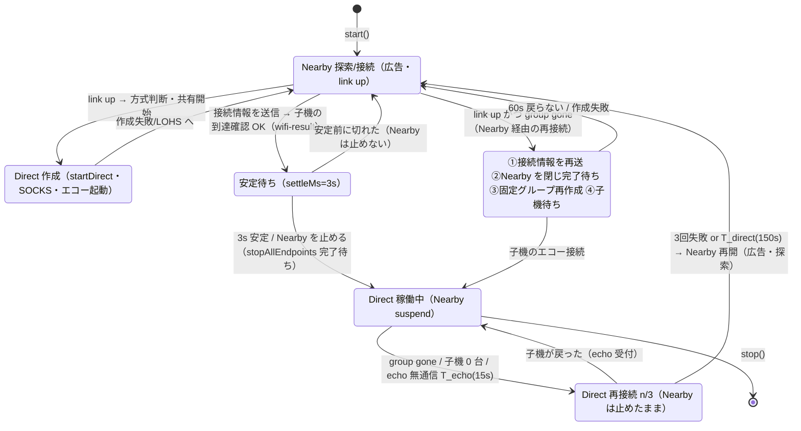
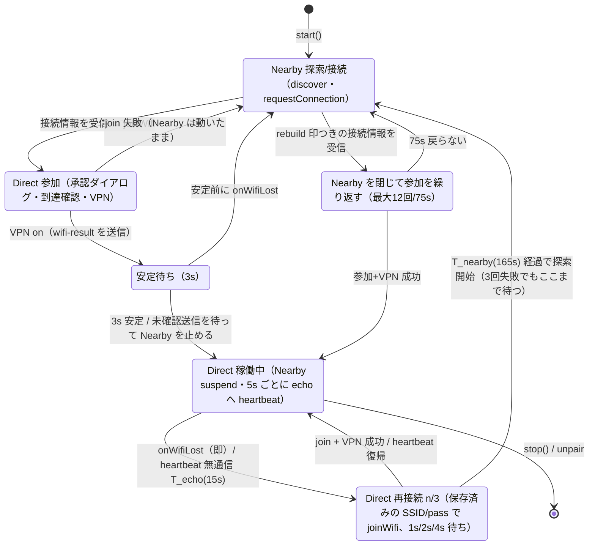
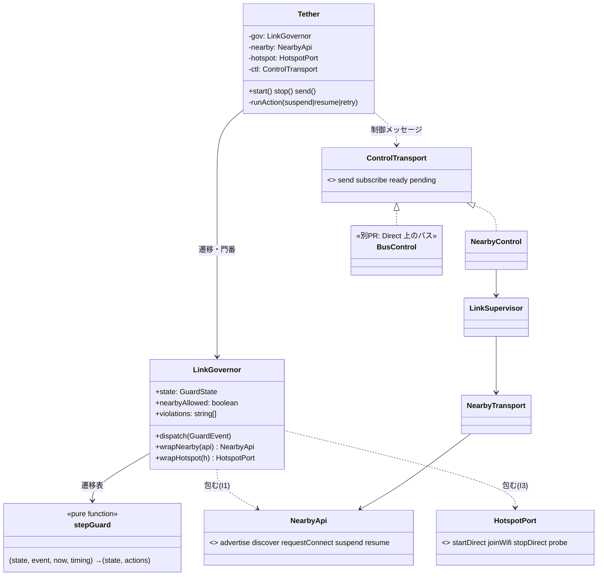

# Nearby と Wi-Fi Direct の使い分け(`nearbyWhileDirect: 'suspend'`)

## なぜ

Direct の固定グループが生きている最中に Nearby が(再)接続すると、GMS が帯域アップグレード先に `WIFI_DIRECT` を選び、
`Remove current P2P group because P2P resource is unavailable` で固定グループを撤去することがある(実機 razr: 09:01:49 / 09:07:46 / 09:20:48 / 09:26:41)。
09:26 は子機 0 台(clients=0)でも起きた。公開 API に帯域アップグレードの抑止・medium 指定の手段が無いため、
**Direct が生きている間は Nearby の広告・探索・接続要求をすべて止め、Direct が切れたときだけ Nearby で探しに行く**。

設定: `TetherConfig.nearbyWhileDirect: 'keep' | 'suspend'`(既定 `'keep'` = 従来どおり)。**両端末で同じ値にする**
(子機は `tether.wifi-result` に `suspend` を載せ、親機は両方が suspend のときだけ Nearby を止める)。

## 三つの閾値(T_echo < T_direct < T_nearby)

基準時刻は「最後に Direct の生存を確認した時刻」(親機 = 子機のエコー接続を最後に受けた時刻、子機 = 自分のハートビートが最後に成功した時刻)。
Wi-Fi 切断・グループ消滅のように切れたと確定した場合は、その検知時刻。ハートビート間隔 hb(既定 5 秒、子機がエコー 9000 へ接続)から決める。

| 名前 | 既定 | 意味 | 総合状態 |
|---|---|---|---|
| hb | 5s | 子機がエコー(親機の 9000)へ接続する間隔。親機はこの接続の有無で子機の生存を見る | |
| T_echo | 15s (hb×3) | 生存信号が途切れた → データ経路の異常。Nearby は止めたまま Direct の復帰を試す(再接続 最大3回) | degraded |
| T_direct | 150s (T_echo + 3×45s) | ここまでに戻らなければ Direct を諦める。**親機**はここで Nearby を再開(広告・探索) | disconnected |
| T_nearby | 165s (T_direct + T_echo) | **子機**はここで Nearby の探索を始める。親機の再開(T_direct)より 15 秒後 | disconnected |

- 親機の戻り(150s) ≤ 子機の探索開始(165s)。子機が、広告していない親機を探し続ける時間を作らない。Nearby は 135 秒以上経ってから始まる。
- 親機は再接続(固定グループの作り直し)を3回使い切ったら T_direct を待たずに Nearby を再開してよい(早く戻る分には子機より先で良い)。子機は使い切っても T_nearby まで待つ。
- 再接続1回 = 待ち(1s / 2s / 4s)+ 参加の待ち 40s(保存済みの接続情報なら承認ダイアログは出ず、通常は数秒)。最悪 (1+40)+(2+40)+(4+40) = 127s ≤ 135s(= T_direct − T_echo)。
- すべて `TetherConfig.directGuard`(echoMs / directMs / nearbyMs / hbIntervalMs / tickMs …)と `TetherConfig.directRetry`(attempts / backoffMs / joinTimeoutMs / attemptMs)で変えられる。
- Nearby 開始後の再試行は従来どおり(LinkSupervisor の指数バックオフ 1s→上限 30s、1 回の接続の待ち 30s、8012/8009 は native の後始末 1.5s のあと探索からやり直し、省電力は 120s 後から 60s 周期)。親機アプリが落ちた場合でも、子機は探索を続け(上限 30s の間隔)、親機が戻れば再接続できる。

## 状態遷移(親機)

group が生きたまま Nearby が戻った場合は、接続情報の再送だけ行う(グループは維持。子機は同じ SSID へ入り直す)。

## 状態遷移(子機)

### 遷移ごとにやること

| 遷移 | やること | 主なログ(DH-LINK / DH-NEARBY / DH-P2P / DH-ECHO) |
|---|---|---|
| Settling → DirectActive | 未確認の送信が ack されるまで最大3s 待つ → 接続を閉じる → 広告・探索・stopAllEndpoints → 1.5s 待つ(`suspend`) | DH-LINK `Nearby を止める`, DH-NEARBY `suspend … / suspend done` |
| DirectActive → Retrying | Nearby は触らない。親機: group が無ければ固定グループ再作成(最大3回)、あれば維持して子機を待つ。子機: 到達確認 → だめなら入り直し(最大3回) | DH-LINK `Direct 再接続 attempt=n/3 reason=…` |
| Retrying → DirectActive | 何もしない(Nearby は再開しない) | DH-LINK `Direct に戻った` |
| Retrying → NearbyActive | `resume`(Nearby の要求を再び受け付ける)→ 広告(親機)/ 探索(子機) | DH-LINK `Nearby を再開(理由=…)`, DH-NEARBY `resume` |
| NearbyActive(親機・group gone)→ Rebuilding | ①接続情報を `rebuild` 印つきで再送し ack を待つ ②Nearby を閉じて完了を待つ ③固定グループを作り直す(エコー・SOCKS・資格情報はそのまま) ④Nearby は止めたまま子機を待つ | DH-LINK `Direct 作り直し: ①〜④` |

## 総合状態(`TetherState.overall`)との対応

総合状態は**データ経路だけ**で決める(Nearby の link には依存しない)。Nearby が up でもグループが無ければ disconnected。

| 状態 | 親機 overall | 子機 overall |
|---|---|---|
| NearbyActive(Direct 未確立) | degraded(共有中・未到達確認)/ disconnected(共有なし) | disconnected(未参加)/ degraded(参加中・VPN 起動中) |
| Settling / DirectActive、生存信号が新しい | connected | connected |
| DirectActive、無通信 ≥ T_echo | degraded | degraded |
| Retrying(再接続中) | degraded | degraded |
| 無通信 ≥ T_direct、または group gone / Wi-Fi 未参加(再接続を使い切った後) | disconnected | disconnected |

`TetherState` に追加(後方互換: 既存フィールドは不変): `nearby: 'up'|'down'|'suspended'`、`overall: 'connected'|'degraded'|'disconnected'`、
`data`(group / echoAt / heartbeat / okAt / reach)。購読は `subscribe` に加え `onOverall(cb)`。

## クラス設計

### 不変条件(`src/link/linkGovernor.ts`)

| # | 不変条件 | 守り方 | 違反したとき |
|---|---|---|---|
| I1 | Direct 稼働中(direct / retrying / rejoining)は Nearby の advertise・discover・requestConnect を出さない | `wrapNearby` が phase を見て拒否(native 側も suspend 中は無視) | 拒否して DH-LINK に `violation I1`(テスト `strictLinkGuard` では `LinkViolation` を throw) |
| I2 | Nearby の再開は T_direct(親機)/ T_nearby(子機)の経過後、または親機が再接続を使い切ったときだけ | 遷移表(`stepGuard`)だけが resume を出す。governor が時間も再確認 | 拒否+`violation I2` |
| I3 | 再接続順序: 接続情報の再送 → Nearby を閉じて完了を待つ → 固定グループ作成 | rebuild 中は Nearby 停止完了までの `startDirect` を拒否 | 拒否+`violation I3` |
| I4 | 遷移は表にある (状態, 事象) だけ | `stepGuard` が表。それ以外は状態不変 | 無視 |
| I5 | 時間は注入(`now`)。governor はタイマーを持たず tick で駆動 | `GovernorOptions.now` | — |

ネイティブ部品(`NearbyApi` / `HotspotPort`)は `Tether` が governor の包んだものでしか使わない(`this.p.nearby` / `this.p.hotspot` の直接参照は無い)。

## 制御メッセージ(Direct 稼働中は Nearby が止まる)

Direct 稼働中に送れるのは echo 上の heartbeat だけ。それ以外は、Direct が切れて Nearby が再開したときにまとめて届く(LinkSupervisor の未確認キューが保持)。

| メッセージ | Direct 稼働中 | 判断 |
|---|---|---|
| heartbeat(生存確認) | echo(9000)への接続。親機は受付時刻、子機は成否を見る | 常時 |
| 到達確認(wifi-result)・接続情報(wifi) | Direct 確立前に Nearby で交換済み | 確立の手順内 |
| tether.unpair | 送れない(子機はローカルで削除、親機の削除は次回 Nearby 再開時…ただし子機が stop するため届かない) | 既知の制限。バス実装後に Direct 上で送る |
| アプリのメッセージ(`send()`、guest-apps など) | 溜まる(`state.pending`)。Nearby 再開後に届く。`ttlMs` 指定のものは期限で捨てる | 暫定。バス実装後に Direct 上で送る |
| 能力交換・方式判断 | Direct 確立前に済み | — |
| ペア追加 | `beginPairing` が `stop()` するので Direct も止まる(従来どおり) | 変更なし |

**Direct 上の軽量メッセージバス(WebSocket / NATS)と Gateway は別 PR。** `src/link/transport.ts` の `ControlTransport` に `BusControl` を差す。
