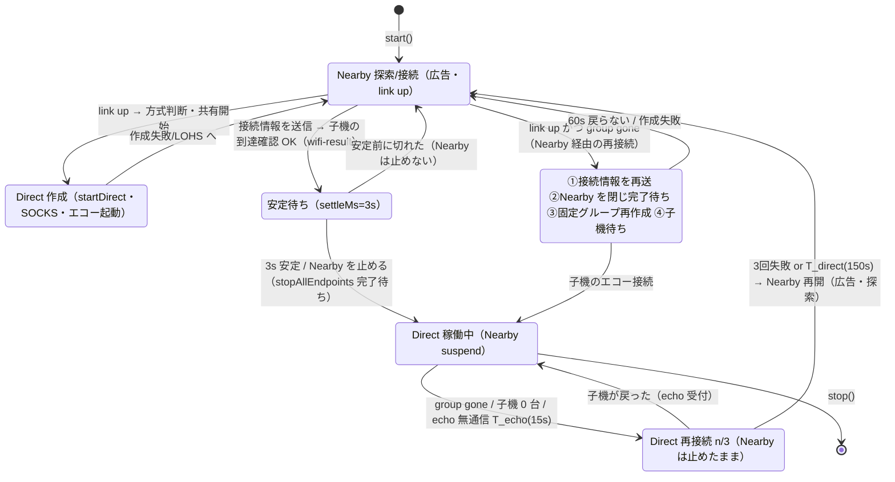
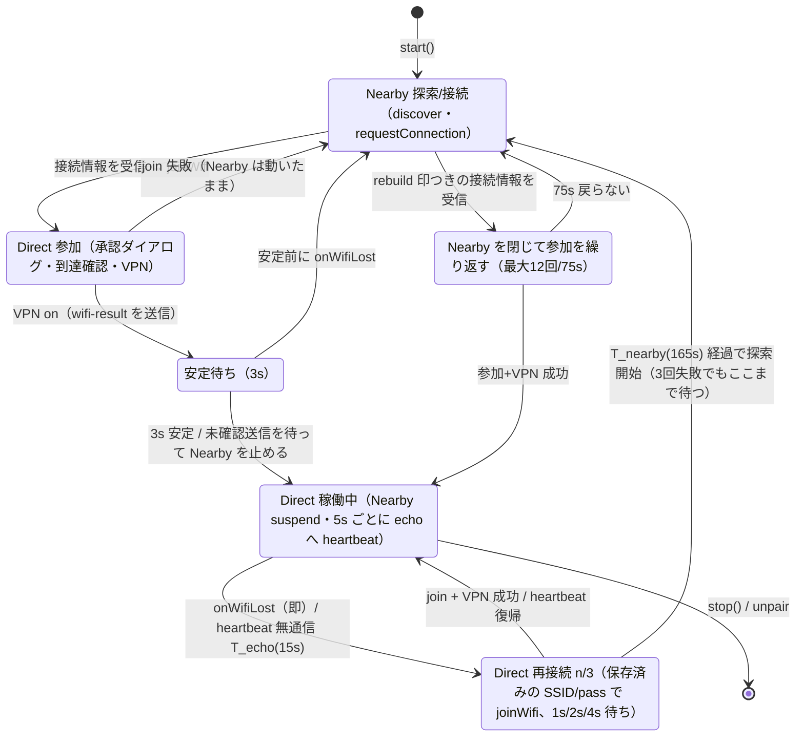
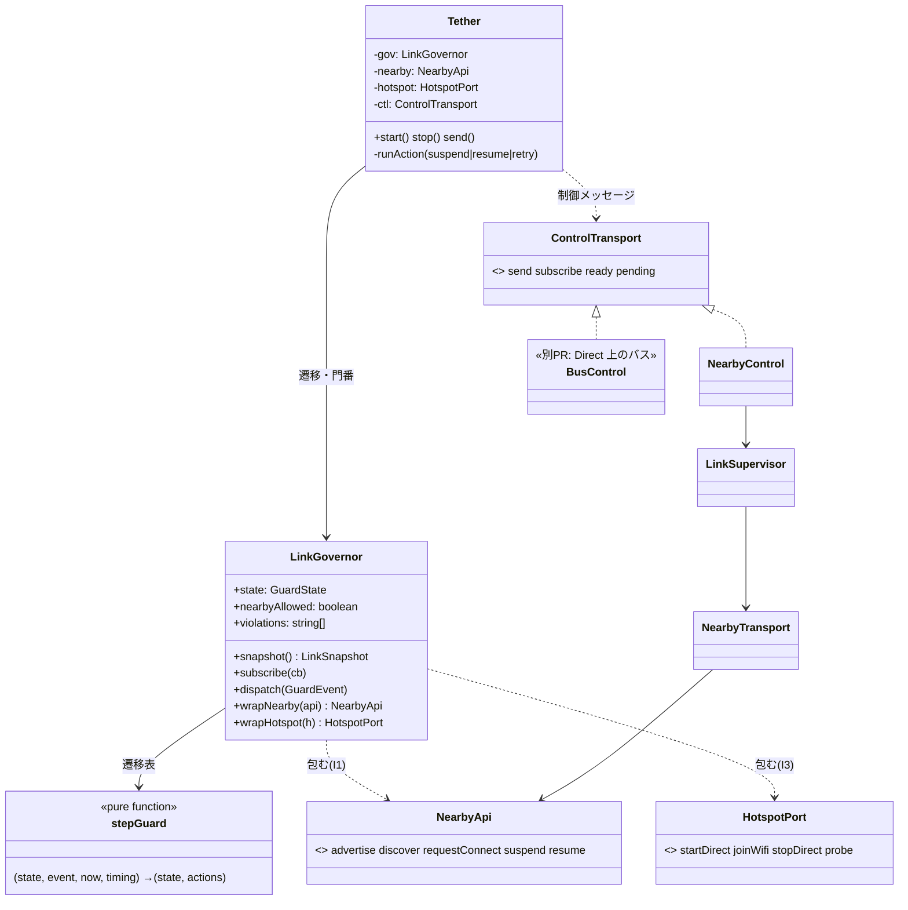

# Nearby と Wi-Fi Direct の使い分け(`nearbyWhileDirect: 'suspend'`)

## なぜ

Direct の固定グループが生きている最中に Nearby が(再)接続すると、GMS が帯域アップグレード先に `WIFI_DIRECT` を選び、
`Remove current P2P group because P2P resource is unavailable` で固定グループを撤去することがある(実機 razr: 09:01:49 / 09:07:46 / 09:20:48 / 09:26:41)。
09:26 は子機 0 台(clients=0)でも起きた。公開 API に帯域アップグレードの抑止・medium 指定の手段が無いため、
**Direct が生きている間は Nearby の広告・探索・接続要求をすべて止め、Direct が切れたときだけ Nearby で探しに行く**。

設定: `TetherConfig.nearbyWhileDirect: 'keep' | 'suspend'`(既定は `DEFAULT_NEARBY_WHILE_DIRECT` = `'keep'`、定義は `src/link/linkMode.ts` の 1 箇所)。
これは**自分の希望**で、実効の方式は接続の最初の hello で相手と交換して決まる(次節)。両端末の設定が食い違っても、実効方式は必ず揃う。

## 方式の交換(hello)

2026-10-21 の実機で、親機=suspend・子機=keep の食い違いにより、keep の子機が heartbeat を送らず、親機が 15 秒後に「生存信号なし」で retrying に入った。
食い違いを設定の運用に頼らず、接続のたびに hello で交換して揃える。

1. 子機は接続のたびに `tether.hello` に自分の希望 `nwd`(`keep`|`suspend`)と共有 timing の版 `tv` を載せる。
2. 親機は hello を受けた時点(能力の交換・Direct 作成より前)で実効方式を決め、`tether.timing`(既存の timing 配布と同じ経路)の `mode` に載せて返す。親機は Direct を作る前に hello を最長 `capsWaitMs` 待つ。
3. 子機は `mode` に従う。両端末の LinkGovernor は同じ実効方式で動く。

| 親機の希望 | 子機の名乗り | 実効 | 理由 |
|---|---|---|---|
| suspend | suspend | **suspend** | 両方 suspend のときだけ |
| suspend | keep | keep | 子機が keep |
| keep | suspend | keep | 親機が keep |
| keep | keep | keep | |
| suspend | 名乗りなし(旧版) | keep | 方式の交換に未対応 |
| suspend | 未着(確定前に Direct が張れた) | keep | 安全側。あとから suspend を名乗られても上げない |

- 確定するまでの実効は keep。suspend へ上げられるのは Direct を作る/参加する前だけ(親機は共有開始の待ちを終えたあと、子機は Wi-Fi 参加の前)。Direct 稼働中は Nearby が止まって交換できないため、途中で suspend に変わることはない。keep へ下げるのはいつでも安全なので許す。
- 旧親機(`mode` なしの timing / timing なし)に当たった新子機も keep。旧版の suspend 子機は自分では suspend のまま動くので、その場合は `wifi-result.suspend`(下)が安全網になる。
- `tether.wifi-result` の `suspend` は残す。交換が成立すれば冗長だが、①旧版(#20)の親機は交換を知らずにこれで子機の方式を判断する ②子機が Direct 参加後に交換結果を受けた取りこぼしの安全網、のため。全端末が更新されたら削除してよい。
- ログ: DH-LINK に `方式: 自分=suspend 相手=keep → 実効=keep(理由)` を 1 行。`linkSnapshot().mode`(`{ self, peer, effective, reason }`。peer は `keep|suspend|legacy|null`)に出る。後方互換の追加フィールド。

## 三つの閾値(T_echo < T_direct < T_nearby)

基準時刻は「最後に Direct の生存を確認した時刻」(親機 = 子機のエコー接続を最後に受けた時刻、子機 = 自分のハートビートが最後に成功した時刻)。
Wi-Fi 切断・グループ消滅のように切れたと確定した場合は、その検知時刻。ハートビート間隔 hb(既定 5 秒、子機がエコー 9000 へ接続)から決める。

| 名前 | 設定名(`TetherConfig.timing.*`) | 既定 | 意味 | 総合状態 |
|---|---|---|---|---|
| hb | `hbIntervalMs` | 5s | 子機がエコー(親機の 9000)へ接続する間隔。親機はこの接続の有無で子機の生存を見る | |
| T_echo | `echoMs` | 15s (hb×3) | 生存信号が途切れた → データ経路の異常。Nearby は止めたまま Direct の復帰を試す(再接続 最大3回) | degraded |
| T_direct | `directMs` | 150s (T_echo + 3×45s) | ここまでに戻らなければ Direct を諦める。**親機**はここで Nearby を再開(広告・探索) | disconnected |
| T_nearby | `nearbyMs` | 165s (T_direct + T_echo) | **子機**はここで Nearby の探索を始める。親機の再開(T_direct)より 15 秒後 | disconnected |
| 開始待ち(安定待ち) | `settleMs` | 3s | Direct 確立を確認してから Nearby を止めるまで | |
| 再接続の回数 | `retryAttempts` | 3 | Nearby に戻る前の Direct 再接続 | degraded |
| 再接続の前の待ち | `retryBackoffMs` | [1s, 2s, 4s] | i 回目の前の待ち | |
| 再接続1回の参加待ち | `retryJoinTimeoutMs` | 40s | 保存済みの接続情報での joinWifi の待ち | |
| 再接続1回の見込み | `retryAttemptMs` | 45s | T_direct の既定の計算に使う | |
| 作り直しの待ち | `rejoinMs` | 60s(子機 +15s) | Nearby 経由の再接続で、相手が Direct に戻るのを待つ | |
| Nearby 再開前の待ち | `nearbyResumeDelayMs` | 0 | 切れ確定から Nearby 再開までの追加の待ち | |
| グループ再作成前の待ち | `groupRebuildDelayMs` | 0 | Nearby を閉じ終えてから固定グループを作るまでの追加の待ち | |
| Nearby 再開後の再試行 | `nearbyRetryBaseMs` / `nearbyRetryMaxMs` | 1s → 上限 30s | LinkSupervisor の指数バックオフ。親機アプリが落ちていても子機は上限間隔で探索を続け、復帰後に再接続する | |
| 初回の Direct 参加 | `joinTimeoutMs` | 180s | 承認ダイアログを含む(JOIN_TIMEOUT_MS) | |
| 判定周期 | `tickMs` | 1s | 状態機械の tick | |

- 親機の戻り(150s) ≤ 子機の探索開始(165s)。子機が、広告していない親機を探し続ける時間を作らない。Nearby は 135 秒以上経ってから始まる。
- 親機は再接続(固定グループの作り直し)を3回使い切ったら T_direct を待たずに Nearby を再開してよい(早く戻る分には子機より先で良い)。子機は使い切っても T_nearby まで待つ。
- 再接続1回 = 待ち(1s / 2s / 4s)+ 参加の待ち 40s(保存済みの接続情報なら承認ダイアログは出ず、通常は数秒)。最悪 (1+40)+(2+40)+(4+40) = 127s ≤ 135s(= T_direct − T_echo)。
- Nearby 開始後の再試行は従来どおり(LinkSupervisor の指数バックオフ 1s→上限 30s、1 回の接続の待ち 30s、8012/8009 は native の後始末 1.5s のあと探索からやり直し、省電力は 120s 後から 60s 周期)。親機アプリが落ちた場合でも、子機は探索を続け(上限 30s の間隔)、親機が戻れば再接続できる。

## 状態遷移(親機)

group が生きたまま Nearby が戻った場合は、接続情報の再送だけ行う(グループは維持。子機は同じ SSID へ入り直す)。

## 状態遷移(子機)

### 遷移ごとにやること

| 遷移 | やること | 主なログ(DH-LINK / DH-NEARBY / DH-P2P / DH-ECHO) |
|---|---|---|
| Settling → DirectActive | 未確認の送信が ack されるまで最大3s 待つ → 接続を閉じる → 広告・探索・stopAllEndpoints → 1.5s 待つ(`suspend`) | DH-LINK `Nearby を止める`, DH-NEARBY `suspend … / suspend done` |
| DirectActive → Retrying | Nearby は触らない。親機: group が無ければ固定グループ再作成(最大3回)、あれば維持して子機を待つ。子機: 到達確認 → だめなら入り直し(最大3回) | DH-LINK `Direct 再接続 attempt=n/3 reason=…` |
| Retrying → DirectActive | 何もしない(Nearby は再開しない) | DH-LINK `Direct に戻った` |
| Retrying → NearbyActive | `resume`(Nearby の要求を再び受け付ける)→ 広告(親機)/ 探索(子機) | DH-LINK `Nearby を再開(理由=…)`, DH-NEARBY `resume` |
| NearbyActive(親機・group gone)→ Rebuilding | ①接続情報を `rebuild` 印つきで再送し ack を待つ ②Nearby を閉じて完了を待つ ③固定グループを作り直す(エコー・SOCKS・資格情報はそのまま) ④Nearby は止めたまま子機を待つ | DH-LINK `Direct 作り直し: ①〜④` |

## 総合状態(`TetherState.overall`)との対応

総合状態は**データ経路だけ**で決める(Nearby の link には依存しない)。Nearby が up でもグループが無ければ disconnected。

| 状態 | 親機 overall | 子機 overall |
|---|---|---|
| NearbyActive(Direct 未確立) | degraded(共有中・未到達確認)/ disconnected(共有なし) | disconnected(未参加)/ degraded(参加中・VPN 起動中) |
| Settling / DirectActive、生存信号が新しい | connected | connected |
| DirectActive、無通信 ≥ T_echo | degraded | degraded |
| Retrying(再接続中) | degraded | degraded |
| 無通信 ≥ T_direct、または group gone / Wi-Fi 未参加(再接続を使い切った後) | disconnected | disconnected |

`TetherState` に追加(後方互換: 既存フィールドは不変): `nearby: 'up'|'down'|'suspended'`、`overall: 'connected'|'degraded'|'disconnected'`、
`data`(group / echoAt / heartbeat / okAt / reach)。購読は `subscribe` に加え `onOverall(cb)`。

## クラス設計

### 不変条件(`src/link/linkGovernor.ts`)

| # | 不変条件 | 守り方 | 違反したとき |
|---|---|---|---|
| I1 | Direct 稼働中(direct / retrying / rejoining)は Nearby の advertise・discover・requestConnect を出さない | `wrapNearby` が phase を見て拒否(native 側も suspend 中は無視) | 拒否して DH-LINK に `violation I1`(テスト `strictLinkGuard` では `LinkViolation` を throw) |
| I2 | Nearby の再開は T_direct(親機)/ T_nearby(子機)の経過後、または親機が再接続を使い切ったときだけ | 遷移表(`stepGuard`)だけが resume を出す。governor が時間も再確認 | 拒否+`violation I2` |
| I3 | 再接続順序: 接続情報の再送 → Nearby を閉じて完了を待つ → 固定グループ作成 | rebuild 中は Nearby 停止完了までの `startDirect` を拒否 | 拒否+`violation I3` |
| I6 | joinWifi（子機の Direct 参加）は**どの phase でも許す** | `wrapHotspot` が通し、phase と Nearby 停止の有無を DH-LINK に 1 行残す | 違反ではない（追跡用ログのみ） |
| I4 | 遷移は表にある (状態, 事象) だけ | `stepGuard` が表。それ以外は状態不変 | 無視 |
| I5 | 時間は注入(`now`)。governor はタイマーを持たず tick で駆動 | `GovernorOptions.now` | — |

**I6 の判断（joinWifi を許す理由）**: ①初回の参加は Nearby で接続情報を受け取った直後（phase = nearby / settling）に Nearby 接続中のまま行う設計で、禁止すると Direct を確立できない
②再接続・作り直しの参加は Nearby を止めたまま行う（retrying / rejoining）③参加は子機が Wi-Fi クライアントとして入るだけで、Nearby の接続や帯域アップグレードを起こさない（P2P の GO 側のリソースは親機）。禁止するのは Nearby 側（I1）と親機のグループ作成（I3）。

### ネイティブを迂回させない仕組み

- `Tether` は governor の包んだ `this.nearby` / `this.hotspot` しか使わない(`this.p.nearby` / `this.p.hotspot` の直接参照は無い)。
- `src/api/index.ts` は `nativePlatform`（生の部品）を**公開しない**。利用側は `getTether()` だけを使う（`getTether` が内部で使う）。
- ESLint `no-restricted-imports`: `modules/*`・`src/nearbyApi.ts`・`src/api/native.ts` を import してよいのは `src/api/native.ts` / `src/nearbyApi.ts` / `src/api/index.ts` だけ。他は lint エラー。
- Nearby のネイティブエラー（8007 など）を画面側が読む用途は、ネイティブ直参照ではなく `tether.onNearbyError(cb)`（読み取り専用）に置き換える。mobile の `host/src/pairing/nearbyEvents.ts` はこれに差し替えられる（別 PR。置き換えまでは読み取り専用の例外として残してよい）。
  比較: 許可リストに残す案は迂回の入口が残る／`onNearbyError` を公開する案は入口が一つで型も付く → 後者を採用。

## 制御メッセージ(Direct 稼働中は Nearby が止まる)

Direct 稼働中に送れるのは echo 上の heartbeat だけ。それ以外は、Direct が切れて Nearby が再開したときにまとめて届く(LinkSupervisor の未確認キューが保持)。

| メッセージ | Direct 稼働中 | 判断 |
|---|---|---|
| heartbeat(生存確認) | echo(9000)への接続。親機は受付時刻、子機は成否を見る | 常時 |
| 到達確認(wifi-result)・接続情報(wifi) | Direct 確立前に Nearby で交換済み | 確立の手順内 |
| tether.unpair | 送れない(子機はローカルで削除、親機の削除は次回 Nearby 再開時…ただし子機が stop するため届かない) | 既知の制限。バス実装後に Direct 上で送る |
| アプリのメッセージ(`send()`、guest-apps など) | 溜まる(`state.pending`)。Nearby 再開後に届く。`ttlMs` 指定のものは期限で捨てる | 暫定。バス実装後に Direct 上で送る |
| 能力交換・方式判断 | Direct 確立前に済み | — |
| ペア追加 | `beginPairing` が `stop()` するので Direct も止まる(従来どおり) | 変更なし |

**Direct 上の軽量メッセージバス(WebSocket / NATS)と Gateway は別 PR。** `src/link/transport.ts` の `ControlTransport` に `BusControl` を差す。

## 時間の設定(`TetherConfig.timing`)

型・既定・範囲は `src/link/timingConfig.ts`。決め方:

1. 既定 → `TetherConfig.timing`(アプリが渡す)→ 開発・検証用の保存値(`tether.setTimingOverride({...})` が kv(SecureStore)に保存し、**次の `start()`** から効く。再ビルド不要。`null` で消す)の順に重ねる。
2. 範囲外・不正値(`NaN`、下限未満など)は既定に丸めてログ(`DH-LINK timing: …`)。T_echo は hb×3、T_direct は T_echo + 回数×attemptMs、T_nearby は T_direct + T_echo が既定。
3. 大小関係 `T_echo < T_direct < T_nearby` が破れたら補正してログ(T_direct ≤ T_echo → T_echo×2、T_nearby ≤ T_direct → T_direct + T_echo)。再接続が `T_direct − T_echo` に収まらない設定は注意をログに出す(補正はしない)。
4. `start()` ごとに、実際に使う値を `DH-LINK timing role=… {…}` として 1 回ログに出す。
5. **親機が正**: suspend 方式では親機が接続のたびに共有分(`hbIntervalMs / echoMs / directMs / nearbyMs / settleMs / retry* / rejoinMs`)を `tether.timing` で子機へ配り、子機は自分の値を上書きして採用する(`DH-LINK timing 親機の設定を採用`)。理由: 「親機の戻り ≤ 子機の探索開始」は両端末の値の対応で成り立つので、端末ごとに設定が食い違うと子機が先に探索へ戻る。`tickMs / joinTimeoutMs / nearbyRetry* / *DelayMs` は端末ごと。
   配布手段の比較: (a)アプリが `TetherConfig` を渡す ─ 両端末に同じ値を入れる運用が要り食い違いやすい / (b)保存値を起動時に読む ─ 再ビルド不要だが端末ごと / (c)親機→子機へ制御メッセージで配る(採用)─ 親機に入れれば揃う。Direct 稼働中は Nearby が止まるので、配るのは Nearby でつながっている間(確立前・再接続時)。Direct 上のバスができたら、バス経由で稼働中にも配れる。

## 画面に出す状態(`tether.linkSnapshot()` / `onLink(cb)` / `state.linkState`)

`state.linkState`(= `snapshot().state`)は既存の `subscribe` でそのまま流れる(`useTether` が受ける `TetherState` に追加のみ)。全体は `linkSnapshot()`、購読は `onLink(cb)`。

| 内部名 | 日本語ラベル(`LINK_LABELS`。i18n はこの表だけ差し替える) | 状態機械の phase / 条件 | 待っているもの(`waiting.for`) |
|---|---|---|---|
| stopped | 停止中 | 未開始 | — |
| keep-mode | Nearby と Direct を併用中 | keep 方式で Direct が張れている | — |
| nearby-searching | Nearby で探しています | 子機・Nearby 未接続 | — |
| nearby-waiting | Nearby で待っています | 親機・Nearby 未接続(広告中) | — |
| nearby-connected | Nearby でつながっています | Nearby 接続中・Direct 未確立 | — |
| nearby-resumed | Direct が切れたため Nearby で探しています | 再接続を尽くして Nearby を再開した直後 | — |
| direct-creating | Direct を作っています | 親機 share=starting | — |
| direct-joining | Direct に参加しています | 子機 wifi=joining | — |
| direct-settling | Direct を確認しています | settling | settle |
| direct-active | Direct 接続中 | direct(Nearby 停止中) | T_echo |
| direct-retrying | Direct 再接続中 {n}/{max} | retrying | T_direct(親機)/ T_nearby(子機) |
| direct-rebuilding | Direct を作り直しています | rejoining | rejoin |

`LinkSnapshot`: `state`(name / label / phase / enteredAt / elapsedSec / waiting{for, deadlineAt(epoch ms), remainingMs} / attempt{n,max})、`overall`、
`path`(nearby up|down|suspended / group / echoAt / reach / heartbeat)、`history`(直近 50 件の遷移: at / from / to / event / reason。SSID・パス・共有コードは含まない)、`timing`(有効な設定値と状態機械の時間)。

画面の想定: ホームの接続行 = `state.label` + `overall`(色)/ 待つ画面 = `label` と `waiting.deadlineAt` のカウントダウン、再接続中は `attempt` / 診断画面 = `history` と `path`・`timing` の一覧。
